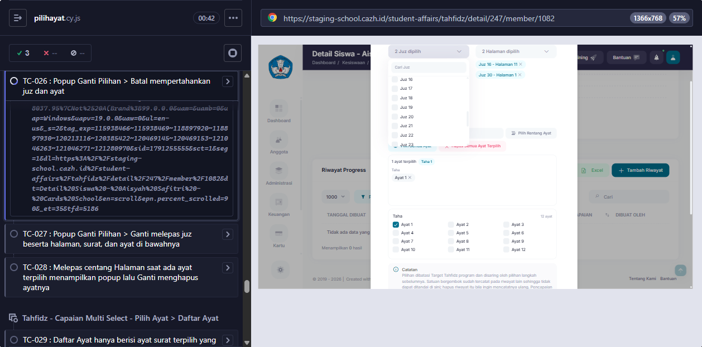

# BUG-002

<!-- AUTO:START -->
## Evidence otomatis (2026-10-06)

**Judul:** Popup Ganti Pilihan > Batal: checkbox juz/halaman tetap tidak tercentang padahal pilihan tidak berubah
**TC terkait:** TC-026

Keterangan diff assertion: baris `-` = hasil AKTUAL app, baris `+` = EXPECTED (PRD/keputusan).

### TC-026

<!-- AUTO:END -->
