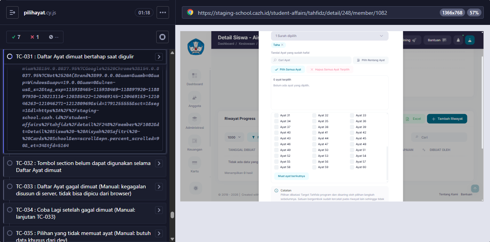

# BUG-004

## Retest 7 Oktober 2026

**PASS → Fixed.** Staging `a9e3c84c` (cherry-pick `2b820ac4`, deploy 7 Okt 2026), Cypress Chrome. TC-031: Daftar Ayat bertambah otomatis saat digulir ke bawah (IntersectionObserver); tombol "Muat ayat berikutnya" tetap ada sebagai cadangan.

<!-- AUTO:START -->
## Evidence otomatis (2026-10-06)

**Judul:** Daftar Ayat tidak dimuat otomatis saat digulir (hanya lewat tombol)
**TC terkait:** TC-031

Keterangan diff assertion: baris `-` = hasil AKTUAL app, baris `+` = EXPECTED (PRD/keputusan).

### TC-031

<!-- AUTO:END -->
