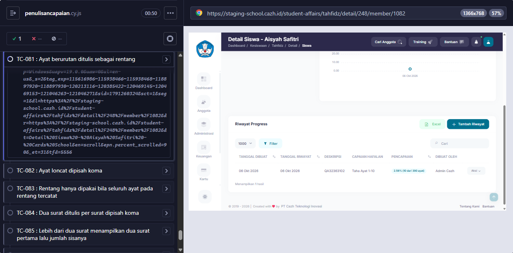
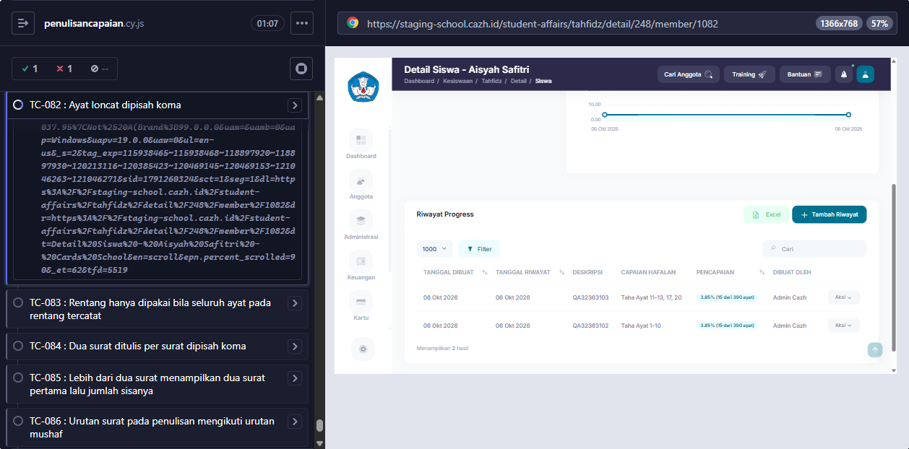
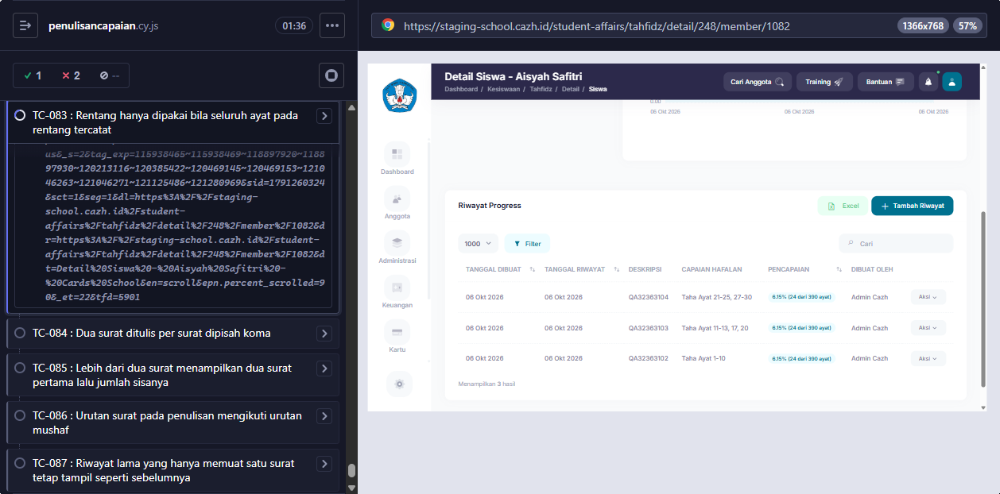
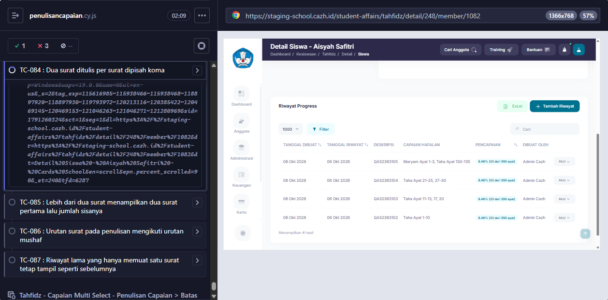
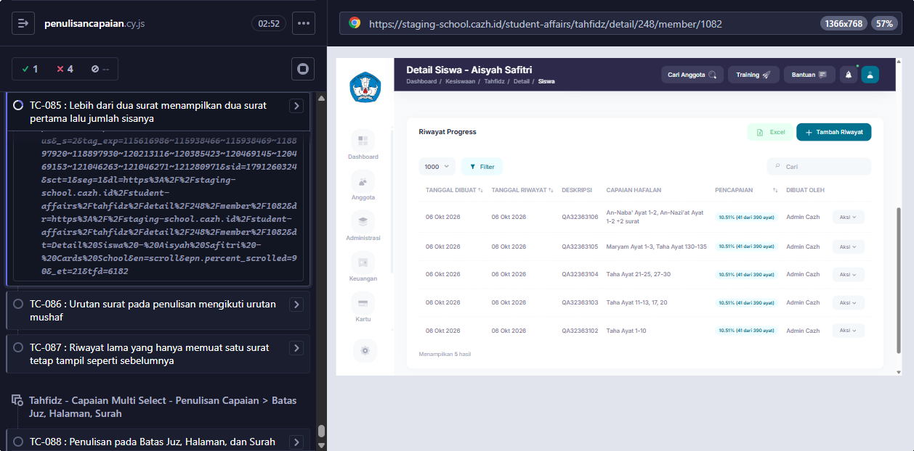
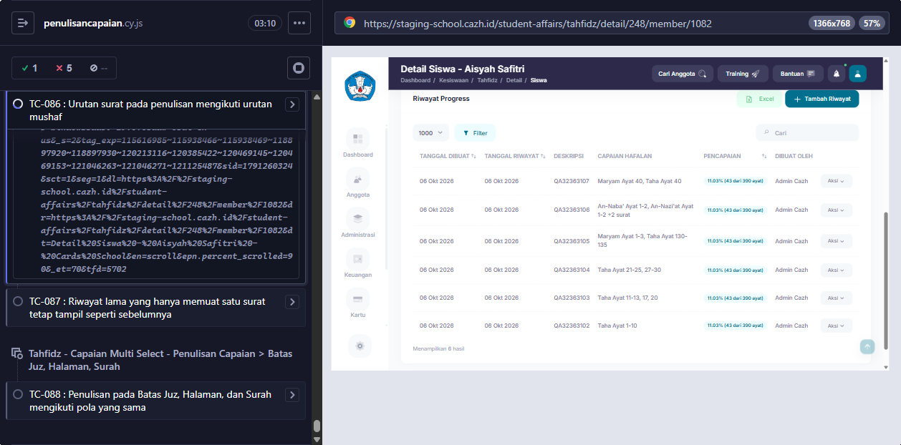
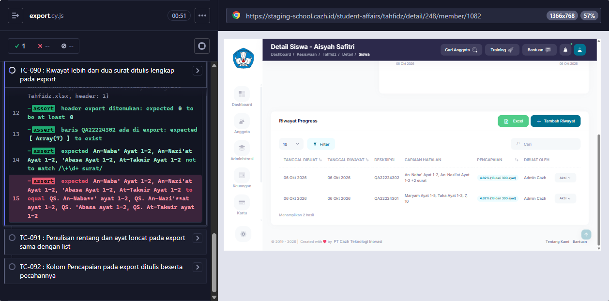
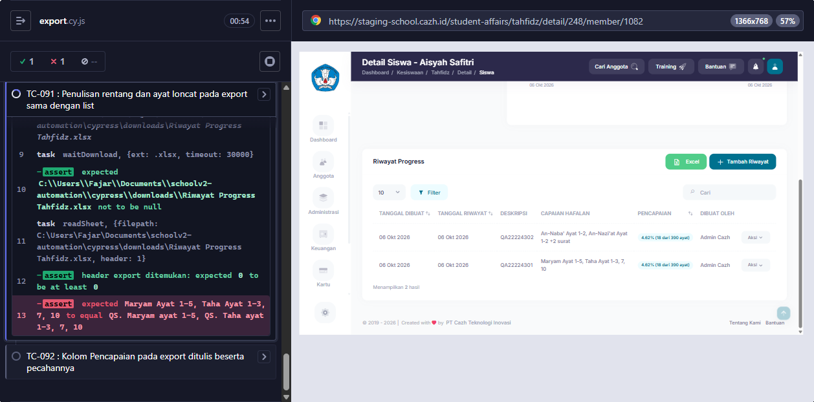

# BUG-005

<!-- AUTO:START -->
## Evidence otomatis (2026-10-06)

**Judul:** Penulisan capaian tanpa 'QS.' dan 'Ayat' kapital (PRD: 'QS. {surat} ayat {ayat}')
**TC terkait:** TC-081, TC-082, TC-083, TC-084, TC-085, TC-086, TC-090, TC-091

Keterangan diff assertion: baris `-` = hasil AKTUAL app, baris `+` = EXPECTED (PRD/keputusan).

### TC-081
```
-'Taha Ayat 1-10'
+'QS. Taha ayat 1-10'
```


### TC-082
```
-'Taha Ayat 11-13, 17, 20'
+'QS. Taha ayat 11-13, 17, 20'
```


### TC-083
```
-'Taha Ayat 21-25, 27-30'
+'QS. Taha ayat 21-25, 27-30'
```


### TC-084
```
-'Maryam Ayat 1-3, Taha Ayat 130-135'
+'QS. Maryam ayat 1-3, QS. Taha ayat 130-135'
```


### TC-085
```
-'An-Naba\' Ayat 1-2, An-Nazi\'at Ayat 1-2 +2 surat'
+'QS. An-Naba\' ayat 1-2, QS. An-Nazi\'at ayat 1-2 +2 surat'
```


### TC-086
```
-'Maryam Ayat 40, Taha Ayat 40'
+'QS. Maryam ayat 40, QS. Taha ayat 40'
```


### TC-090


### TC-091


<!-- AUTO:END -->
