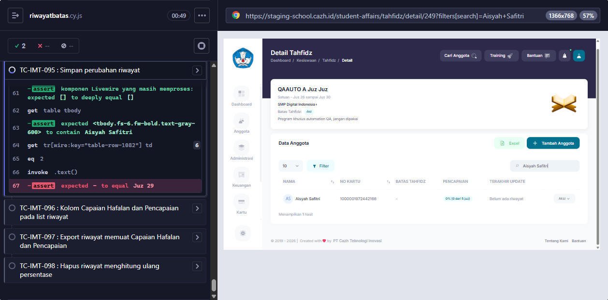
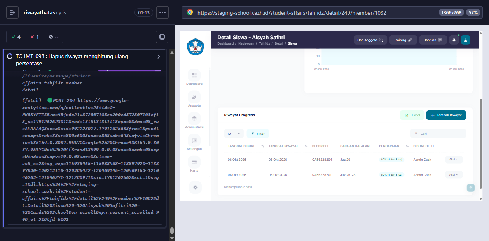

# BUG-007 — Detail program: baris anggota tampil "-", 0%, "Belum ada riwayat" walau anggota punya riwayat

**Modul:** Kesiswaan > Tahfidz > Detail program (list anggota) · **Severity:** High · **Ditemukan:** 6 Oktober 2026 (Cypress, staging commit `2a2a430e`)

## Langkah
1. Login sebagai admin.
2. Siswa yang sama terdaftar di dua program, mis. Aisyah Safitri di Program A (#249, Batas Juz) dan Program D (#253, Batas Surah).
3. Tambah riwayat di Program A (Juz 26-28), lalu tambah riwayat di Program D (An-Naba', An-Nazi'at) **sesudahnya**.
4. Buka Kesiswaan > Tahfidz > Detail Program A, cari Aisyah Safitri.

## Expected
Kolom Batas Tahfidz = `Juz 28`, Pencapaian = `60% (3 dari 5 juz)`, Terakhir Update = tanggal riwayat (PRD Detail Program; TC-IMT-095, 098).

## Actual
Batas Tahfidz `-`, Pencapaian `0% (0 dari 5 juz)`, Terakhir Update `Belum ada riwayat` — seakan anggota belum pernah punya riwayat. Program yang riwayat terbarunya paling akhir dibuat (Program D) tampil benar.
Riwayat di halaman Detail Siswa dan tab Tahfidz Anggota tetap benar (query-nya langsung per program).

## Penyebab (source origin/staging, READ-ONLY)
`app/Models/Member.php`:
```php
public function latest_tahfidz_progress()
{
    return $this->hasOne(TahfidzProgress::class, 'member_id', 'id')
        ->ofMany(['activity_date' => 'max', 'id' => 'max']);
}
```
`MemberDatatable::query()` dan `memberIdsAtUnit()` memanggil
`->with(['latest_tahfidz_progress' => fn ($q) => $q->where('tahfidz_id', $this->tahfidz_id)])`.
Constraint di closure eager load diterapkan **sesudah** subquery `ofMany` memilih riwayat terbaru siswa dari **semua program**, jadi hasilnya kosong bila riwayat terbaru siswa ada di program lain.

Dampak ikutan: filter Batas Tahfidz (`memberIdsAtUnit`) juga memakai relasi yang sama, sehingga anggota bisa tidak ketemu walau posisinya cocok.

## Saran fix
Batasi program **di dalam** agregat, bukan di closure eager load. Contoh (pilih salah satu):
1. Constraint agregat `ofMany` (argumen kedua berupa closure yang masuk ke subquery):
   ```php
   // Member.php — relasi per program, tahfidz_id diisi sebelum query
   public function latest_tahfidz_progress_in(int $tahfidzId)
   {
       return $this->hasOne(TahfidzProgress::class, 'member_id', 'id')
           ->ofMany(['activity_date' => 'max', 'id' => 'max'],
               fn ($q) => $q->where('tahfidz_id', $tahfidzId));
   }
   ```
2. Atau subselect id riwayat terakhir per program di `MemberDatatable::query()`:
   ```php
   ->addSelect(['latest_progress_id' => TahfidzProgress::select('id')
       ->whereColumn('member_id', 'members.id')
       ->where('tahfidz_id', $this->tahfidz_id)
       ->orderByDesc('activity_date')->orderByDesc('id')->limit(1)])
   ```
   lalu muat riwayatnya berdasarkan `latest_progress_id` (juga dipakai `memberIdsAtUnit`).

<!-- AUTO:START -->
## Evidence otomatis (2026-10-06)

**Judul:** Detail program: anggota tampil '-', 0%, 'Belum ada riwayat' bila riwayat terbarunya ada di program lain
**TC terkait:** TC-IMT-095, TC-IMT-098

Keterangan diff assertion: baris `-` = hasil AKTUAL app, baris `+` = EXPECTED (PRD/keputusan).

### TC-IMT-095
```
AssertionError: expected '-' to equal 'Juz 29'
-'-'
+'Juz 29'
```


### TC-IMT-098
```
-'80% (4 dari 5 juz)'
+'60% (3 dari 5 juz)'
```


<!-- AUTO:END -->
