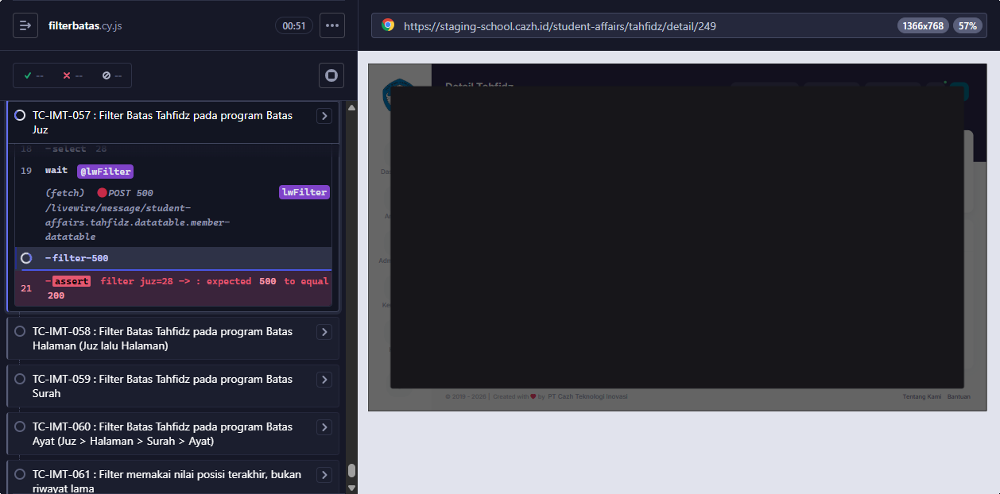
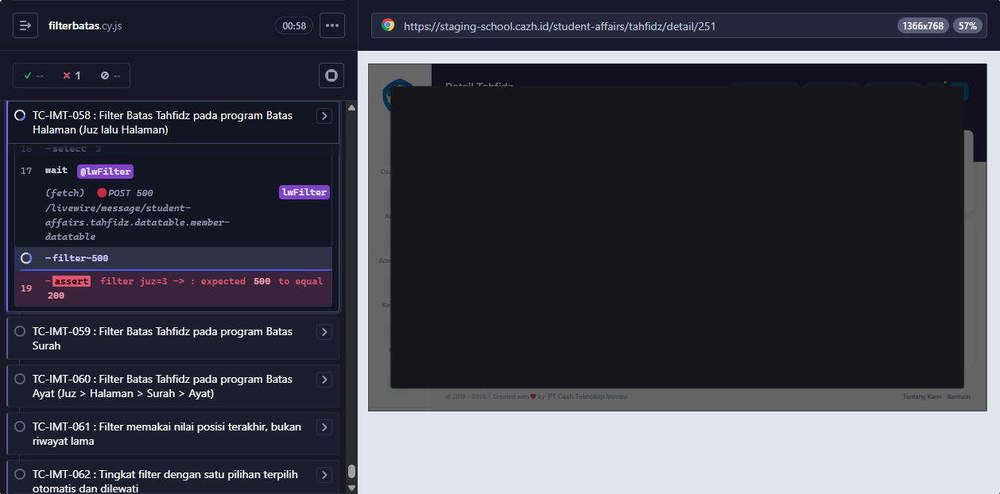
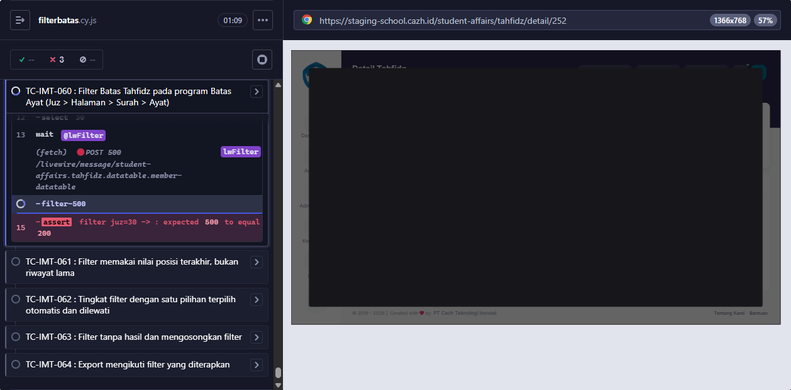
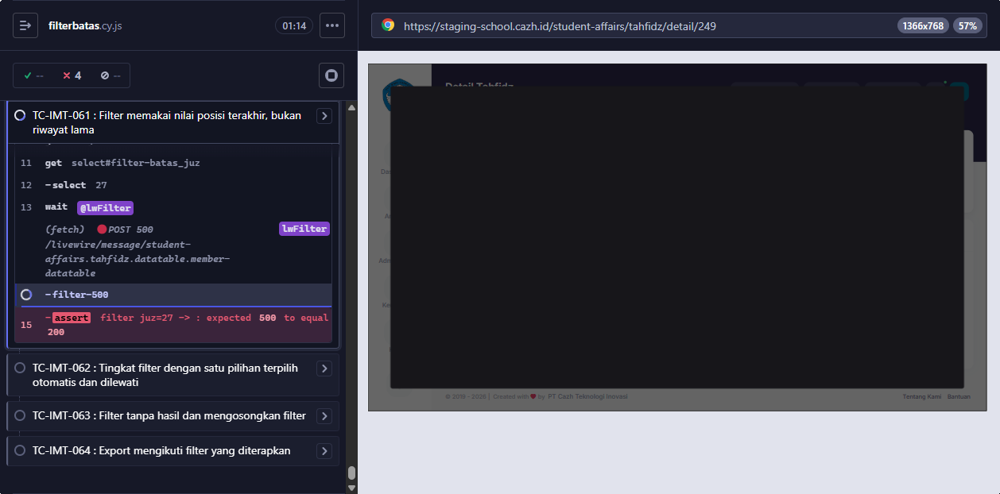
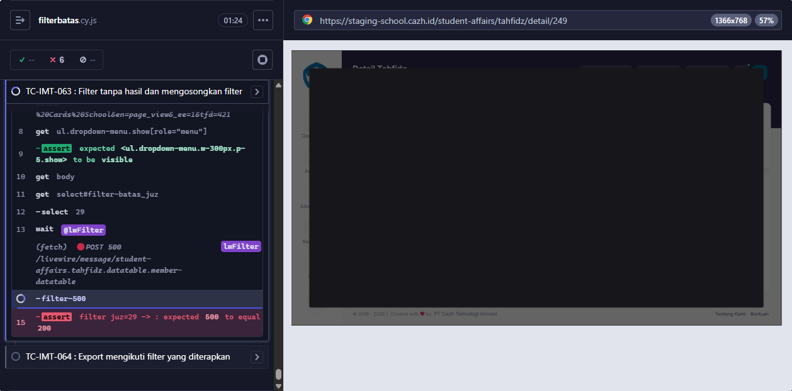
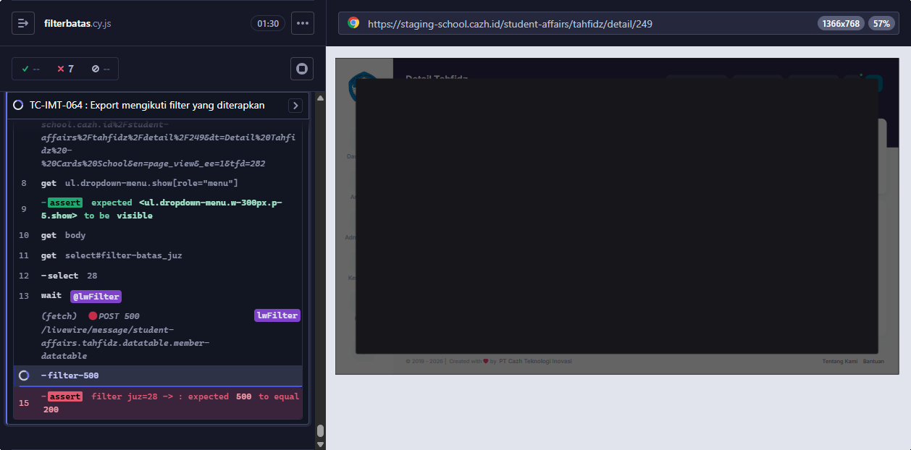

# BUG-008 — Filter Batas Tahfidz di Detail program selalu HTTP 500

**Modul:** Kesiswaan > Tahfidz > Detail program (filter list anggota) · **Severity:** High · **Ditemukan:** 6 Oktober 2026 (Cypress, staging commit `2a2a430e`)

## Langkah
1. Login sebagai admin.
2. Buka Kesiswaan > Tahfidz > Detail program apa pun (mis. QAAUTO A Juz Juz #249).
3. Klik Filter, pilih satu nilai pada Juz (atau Surah untuk program Jenis Surah).
4. Perhatikan Network: `POST /livewire/message/student-affairs.tahfidz.datatable.member-datatable`.

## Expected
List anggota tersaring ke anggota yang posisi terakhirnya = nilai filter; tingkat filter berikutnya muncul (PRD Detail Tahfidz, Filter; TC-IMT-057..064).

## Actual
Request dibalas **HTTP 500** untuk SETIAP nilai (Juz, Surah, program A/B/C/D) — dua run berturut-turut. List tidak berubah, tingkat berikutnya tidak muncul, export ikut tidak bisa difilter.

## Penyebab (source origin/staging + rappasoft/laravel-livewire-tables v1.25.1, READ-ONLY)
`MemberDatatable::filters()` dan `selectedUnitKey()` memanggil `$this->getFilter('batas_<step>')`.
Di rappasoft v1.25.1 (`src/Traits/WithFilters.php`):
```php
public function getFilter(string $filter)
{
    if ($this->hasFilter($filter)) {
        if (in_array($filter, collect($this->filters())->keys()->toArray(), true) && $this->filters()[$filter]->isSelect()) {
            return $this->hasIntegerKeys($filter) ? ... // hasIntegerKeys() juga memanggil filters()
```
Begitu filter punya nilai, `filters()` → `getFilter()` → `filters()` → … **rekursi tanpa akhir** → 500. Saat belum ada nilai `hasFilter()` false, jadi halaman awal tetap normal.

## Saran fix
Di dalam `filters()` (dan `selectedUnitKey()`), baca nilai mentah tanpa lewat `getFilter()`:
```php
$value = $this->filters['batas_' . $step] ?? null;
```
`memberIdsAtUnit()` juga terdampak BUG-007 (relasi `latest_tahfidz_progress`), perbaiki sekalian.

## Retest 7 Oktober 2026

**PASS → Fixed.** Staging `a9e3c84c` (cherry-pick `2b820ac4`, deploy 7 Okt 2026), Cypress Chrome. TC-IMT-057..064: filter membalas 200, bertingkat sampai Ayat, filter tanpa hasil/kosongkan benar, export ikut filter.

<!-- AUTO:START -->
## Evidence otomatis (2026-10-06)

**Judul:** Filter Batas Tahfidz di Detail program selalu HTTP 500 (rekursi filters() <-> getFilter())
**TC terkait:** TC-IMT-057, TC-IMT-058, TC-IMT-059, TC-IMT-060, TC-IMT-061, TC-IMT-063, TC-IMT-064

Keterangan diff assertion: baris `-` = hasil AKTUAL app, baris `+` = EXPECTED (PRD/keputusan).

### TC-IMT-057


### TC-IMT-058


### TC-IMT-059


### TC-IMT-060


### TC-IMT-061


### TC-IMT-063


### TC-IMT-064


<!-- AUTO:END -->
