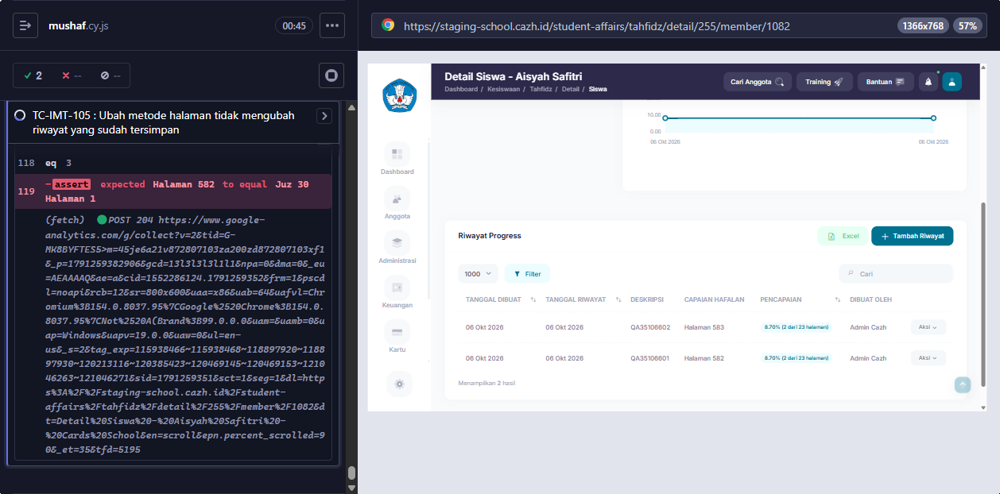

# BUG-010 — Riwayat lama ikut berubah penomoran halamannya setelah metode instansi diganti

**Modul:** Tahfidz > Detail Siswa (kolom Capaian Hafalan) · **Severity:** Medium · **Ditemukan:** 6 Oktober 2026 (Cypress TC-IMT-105, staging `2a2a430e`)
**Status keputusan:** DIKONFIRMASI BUG oleh dev 6 Oktober 2026 (dicek di branch feature/improvement-tahfidz).

## Langkah
1. Login sebagai admin. Instansi SMP Digital Indonesia+ bermetode "Halaman dimulai dari 1 pada setiap juz".
2. Detail Siswa Aisyah Safitri pada Program F (#255, Batas Halaman, Juz 30) > Tambah Riwayat, tandai halaman pertama Juz 30 (mushaf 582), Simpan → Capaian Hafalan `Juz 30 Halaman 1`.
3. Pengaturan > Kesiswaan > Batas Tahfidz > Edit SMP Digital Indonesia+ → metode "Nomor halaman mushaf (1 sampai 604)", Simpan.
4. Buka lagi Detail Siswa Program F.

## Expected (PRD Perilaku Umum)
Riwayat lama tetap `Juz 30 Halaman 1` (penomoran saat dibuat). Riwayat baru memakai penomoran mushaf.

## Actual
Riwayat lama berubah menjadi `Halaman 582`.

## Penyebab (source origin/staging)
`TahfidzProgress::getAchievementDisplay*Attribute()` → `TahfidzUnit::formatUnits()` → `formatPageParts()` memakai `pageNumberingMethod($office)` **saat ini**; metode tidak disimpan di riwayat.

## Saran fix
Simpan metode penomoran (atau label capaian) di riwayat saat dibuat (mis. kolom `page_numbering_method` di `tahfidz_progress`) dan pakai itu ketika memformat; riwayat lama tanpa nilai = metode saat ini.

<!-- AUTO:START -->
## Evidence otomatis (2026-10-06)

**Judul:** Riwayat lama ikut berubah penomoran halamannya setelah metode instansi diganti
**TC terkait:** TC-IMT-105

Keterangan diff assertion: baris `-` = hasil AKTUAL app, baris `+` = EXPECTED (PRD/keputusan).

### TC-IMT-105
```
-'Halaman 582'
+'Juz 30 Halaman 1'
```


<!-- AUTO:END -->
