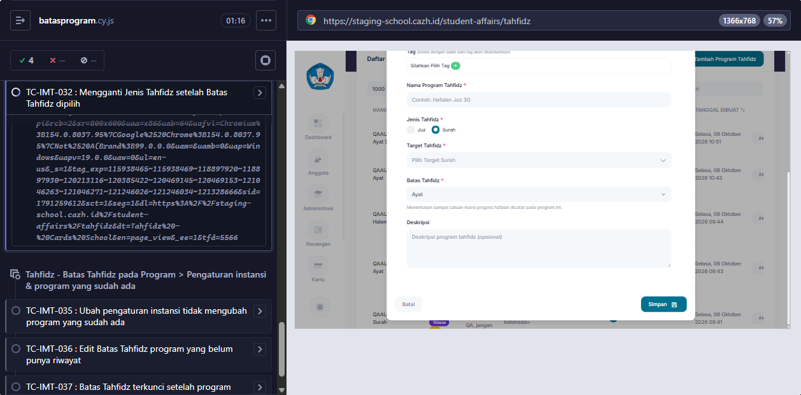

# BUG-011 — Ganti Jenis Tahfidz: Batas diganti default instansi (bukan Surah) dan keterangan tidak tampil

**Modul:** Kesiswaan > Tahfidz > Tambah/Edit Program · **Severity:** Low · **Ditemukan:** 6 Oktober 2026 (Cypress TC-IMT-032, staging `2a2a430e`)
**Status keputusan:** DIKONFIRMASI BUG oleh dev 6 Oktober 2026 (dicek di branch feature/improvement-tahfidz).

## Langkah
1. Login sebagai admin > Kesiswaan > Tahfidz > Tambah Tahfidz (form TIDAK disimpan).
2. Instansi SMP Digital Indonesia+ (default Batas = Ayat), Jenis Juz, pilih Batas Tahfidz = Halaman.
3. Ganti Jenis Tahfidz ke Surah.

## Expected (PRD Tambah Tahfidz, Validasi b)
Halaman tidak tersedia untuk Jenis Surah → Batas diganti **Surah** dan tampil keterangan "Pilihan Batas Tahfidz disesuaikan karena Jenis Tahfidz diubah."

## Actual
Batas berubah ke **Ayat** (default instansi) dan keterangan tidak tampil.

## Penyebab (source origin/staging)
- `StudentAffairs/Tahfidz/Index.php::updatedTahfidzType()` mengisi `TahfidzUnit::defaultLimit($office, $type)` (default instansi), bukan Surah.
- Keterangan memakai `session()->flash('info', ...)`, sedangkan komponen `x-alert.notification` hanya merender `success`, `error`, `session_expired`.

## Saran fix
Pakai `TahfidzUnit::LIMIT_SURAH` bila nilai lama tidak tersedia untuk Jenis Surah (sesuai PRD), dan render flash `info` (atau keterangan di bawah field Batas Tahfidz).

<!-- AUTO:START -->
## Evidence otomatis (2026-10-06)

**Judul:** Ganti Jenis Tahfidz: Batas diganti default instansi (bukan Surah) dan keterangan 'disesuaikan' tidak tampil
**TC terkait:** TC-IMT-032

Keterangan diff assertion: baris `-` = hasil AKTUAL app, baris `+` = EXPECTED (PRD/keputusan).

### TC-IMT-032
```
-'ayat'
+'surah'
```


<!-- AUTO:END -->
