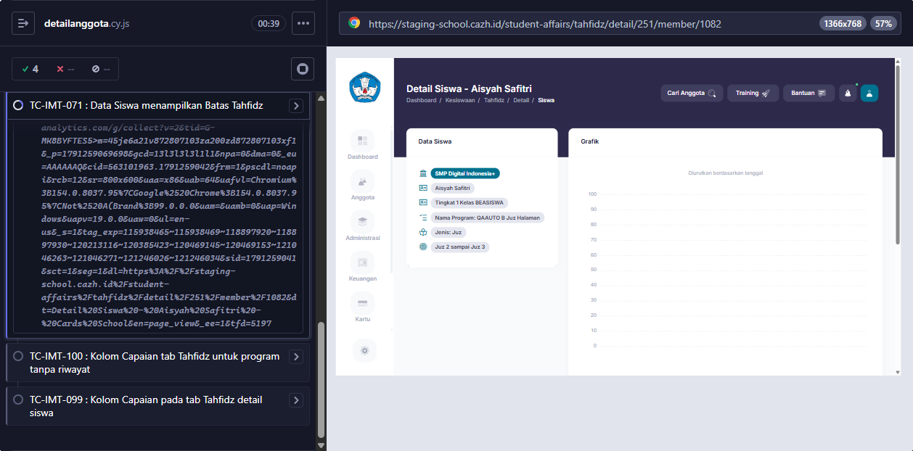

# BUG-012 — Card Data Siswa (Detail Siswa Tahfidz) tidak menampilkan Batas Tahfidz

**Modul:** Tahfidz > Detail Siswa · **Severity:** Low · **Ditemukan:** 6 Oktober 2026 (element analysis #2/#3 + Cypress TC-IMT-071)
**Status keputusan:** DIKONFIRMASI BUG oleh dev 6 Oktober 2026 (dicek di branch feature/improvement-tahfidz).

## Langkah
1. Login sebagai admin.
2. Buka Detail Siswa Aisyah Safitri pada Program B (#251, Batas Halaman).
3. Lihat card Data Siswa.

## Expected (PRD Detail Siswa, Data Siswa poin 7)
Card memuat Batas Tahfidz program, mis. "Batas Tahfidz: Halaman".

## Actual
Card hanya berisi instansi, nama, tingkat/kelas, Nama Program, Jenis, dan target (`Juz 2 sampai Juz 3`).

## Lokasi source
`resources/views/student-affairs/tahfidz/member-detail.blade.php` (card "Data {{ studentLabel }}").

## Saran fix
Tambah baris `Batas Tahfidz: {{ TahfidzUnit::unitLabel($tahfidz->tahfidz_limit) }}` (badge seperti di Detail Program).

<!-- AUTO:START -->
## Evidence otomatis (2026-10-06)

**Judul:** Card Data Siswa (Detail Siswa Tahfidz) tidak menampilkan Batas Tahfidz
**TC terkait:** TC-IMT-071

Keterangan diff assertion: baris `-` = hasil AKTUAL app, baris `+` = EXPECTED (PRD/keputusan).

### TC-IMT-071
```
AssertionError: Timed out retrying after 10000ms: Data Siswa menyebut Batas Tahfidz: expected ' Data Siswa SMP Digital Indonesia+ Aisyah Safitri Tingkat 1 Kelas BEASISWA Nama Program: QAAUTO B Juz Halaman Jenis: Juz Juz 2 sampai Juz 3 ' to match /Batas( Tahfidz)?:?\s*Halaman/i
```


<!-- AUTO:END -->
