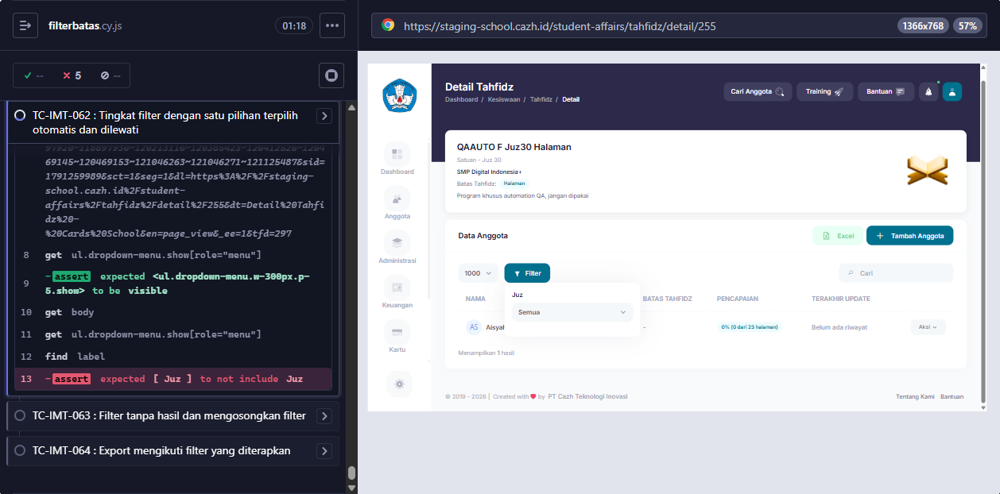

# BUG-013 — Filter Batas Tahfidz: tingkat dengan satu pilihan tetap ditampilkan

**Modul:** Kesiswaan > Tahfidz > Detail program (filter) · **Severity:** Low · **Ditemukan:** 6 Oktober 2026 (Cypress TC-IMT-062)
**Status keputusan:** DIKONFIRMASI BUG oleh dev 6 Oktober 2026 (dicek di branch feature/improvement-tahfidz).

## Langkah
1. Login sebagai admin > Detail program QAAUTO F Juz30 Halaman (#255, target hanya Juz 30).
2. Klik Filter.

## Expected (PRD Detail Tahfidz, Filter c)
Tingkat Juz (hanya satu pilihan: Juz 30) dipilih otomatis dan dilewati; filter langsung menampilkan Halaman.

## Actual
Filter Juz tetap tampil (label `['Juz']`), Halaman belum muncul.

## Penyebab (source origin/staging)
`MemberDatatable::filters()` — komentar docblock: "Tingkat yang pilihannya tinggal satu tidak ditawarkan", tetapi loop tidak memeriksa `count($options) === 1` (bandingkan `MemberDetail::buildUnitOptions()` yang melakukannya).

## Saran fix
Dalam loop: bila `count($options) === 1`, isi `$chosen[$step]` dengan nilai satu-satunya dan `continue` tanpa menambah filter. `selectedUnitKey()` juga perlu mengisi tingkat yang dilewati.

<!-- AUTO:START -->
## Evidence otomatis (2026-10-06)

**Judul:** Filter Batas Tahfidz: tingkat dengan satu pilihan tetap ditampilkan
**TC terkait:** TC-IMT-062

Keterangan diff assertion: baris `-` = hasil AKTUAL app, baris `+` = EXPECTED (PRD/keputusan).

### TC-IMT-062
```
AssertionError: expected [ 'Juz' ] to not include 'Juz'
```


<!-- AUTO:END -->
