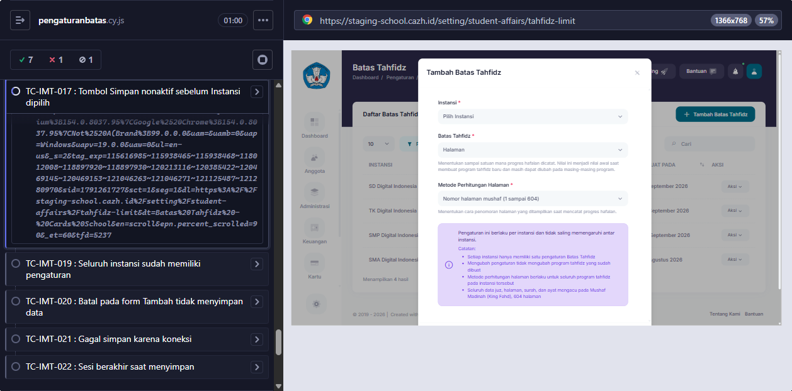

# BUG-014 — Form Tambah pengaturan Batas Tahfidz: Simpan aktif sebelum Instansi dipilih

**Modul:** Pengaturan > Kesiswaan > Batas Tahfidz · **Severity:** Low · **Ditemukan:** 6 Oktober 2026 (Cypress TC-IMT-017; form TIDAK pernah disimpan)
**Status keputusan:** DIKONFIRMASI BUG oleh dev 6 Oktober 2026 (dicek di branch feature/improvement-tahfidz).

## Langkah
1. Login sebagai admin > Pengaturan > Kesiswaan > Batas Tahfidz > Tambah Batas Tahfidz.
2. Jangan pilih Instansi; perhatikan tombol Simpan.

## Expected (PRD)
Simpan nonaktif sampai Instansi dipilih. Bila tetap terkirim, pesan "Lengkapi seluruh field yang wajib diisi."

## Actual
Simpan aktif. Validasi server memakai pesan bawaan Laravel (bukan teks PRD).

## Lokasi source
`resources/views/setting/student-affairs/tahfidz-limit/index.blade.php` (tombol `x-buttons.submit`), `app/Http/Livewire/Setting/StudentAffairs/TahfidzLimit/Index.php` (rules/messages).

## Saran fix
`:disabled="!$office"` pada tombol Simpan dan pesan validasi `required` = "Lengkapi seluruh field yang wajib diisi."

<!-- AUTO:START -->
## Evidence otomatis (2026-10-06)

**Judul:** Form Tambah pengaturan Batas Tahfidz: Simpan aktif sebelum Instansi dipilih
**TC terkait:** TC-IMT-017

Keterangan diff assertion: baris `-` = hasil AKTUAL app, baris `+` = EXPECTED (PRD/keputusan).

### TC-IMT-017
```
AssertionError: Timed out retrying after 10000ms: expected '<button.btn.font-weight-bold.ms-auto.btn-primary>' to be 'disabled'
```


<!-- AUTO:END -->
