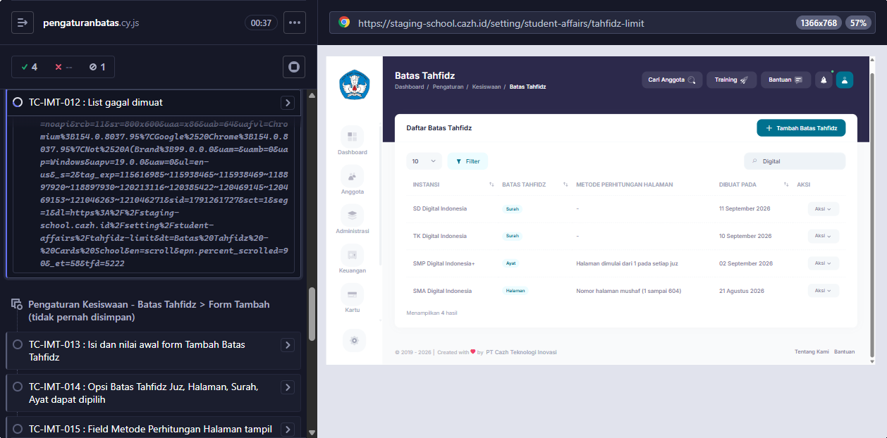
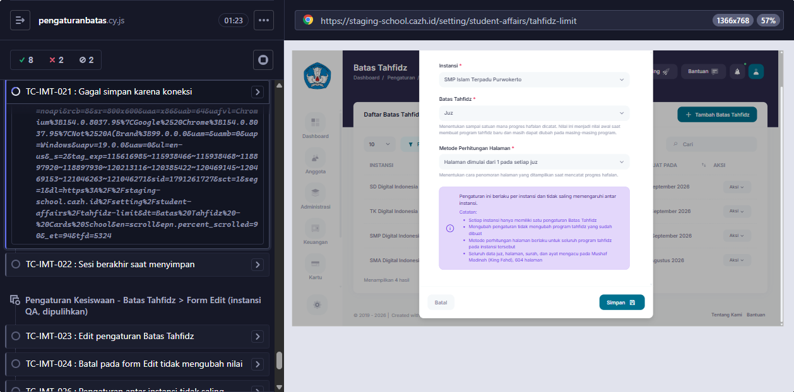
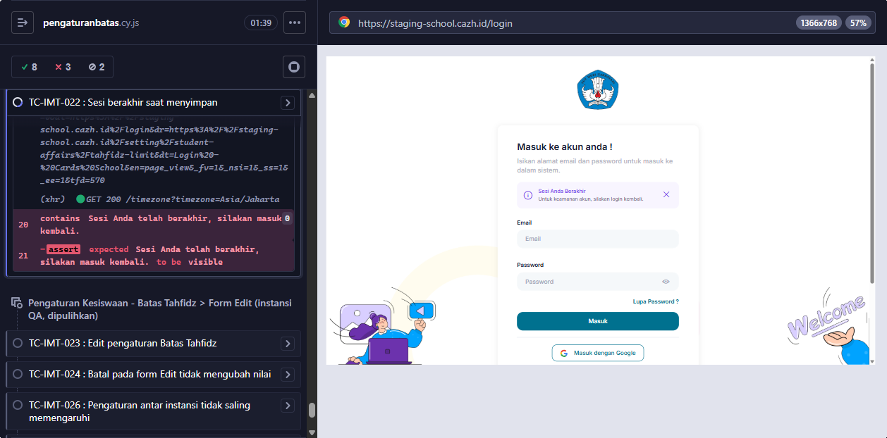

# BUG-015 — Pengaturan Batas Tahfidz: tidak ada pesan gagal muat / gagal simpan, dan teks sesi berakhir bukan versi PRD

**Modul:** Pengaturan > Kesiswaan > Batas Tahfidz · **Severity:** Low · **Ditemukan:** 6 Oktober 2026 (Cypress TC-IMT-012, 021, 022; staging `2a2a430e`)
**Status keputusan:** DIKONFIRMASI BUG oleh dev 6 Oktober 2026 (A6).

Simulasi di test (tidak ada data yang tersimpan):
- Koneksi putus = request Livewire digagalkan lewat `cy.intercept(..., { forceNetworkError: true })` — request tidak sampai server.
- Sesi berakhir = cookie sesi dihapus saat form terbuka.

## TC-IMT-012 — List gagal dimuat
1. Login sebagai admin > Pengaturan > Kesiswaan > Batas Tahfidz.
2. Putus koneksi (DevTools > Network > Offline), ketik di kolom Cari.

**Expected (PRD):** "Gagal memuat data, periksa koneksi Anda dan coba lagi." + tombol **Coba Lagi** yang memuat ulang list.
**Actual:** tidak ada pesan maupun tombol Coba Lagi; tabel tetap menampilkan data lama tanpa keterangan.

## TC-IMT-021 — Gagal simpan karena koneksi
1. Tambah Batas Tahfidz, pilih Instansi, Batas, Metode.
2. Putus koneksi, klik Simpan.

**Expected (PRD):** "Gagal menyimpan, periksa koneksi Anda dan coba lagi.", isian form tetap.
**Actual:** tidak ada pesan apa pun (isian tetap). Bagian "cegah double submit" belum diuji (butuh simpan sungguhan).

## TC-IMT-022 — Sesi berakhir saat menyimpan
1. Buka form Tambah, isi Instansi.
2. Sesi berakhir (logout di tab lain / cookie hilang), klik Simpan.

**Expected (PRD):** "Sesi Anda telah berakhir, silakan masuk kembali." lalu diarahkan ke login.
**Actual:** diarahkan ke `/login` dengan notifikasi umum **"Sesi Anda Berakhir — Untuk keamanan akun, silakan login kembali."** (`x-alert.notification`, flash `session_expired` dari `JwtVerifyMiddleware`). Perilaku sudah benar, hanya teksnya berbeda dari PRD.

## Lokasi source
- `app/Http/Livewire/Setting/StudentAffairs/TahfidzLimit/{Index,Datatable}.php`, `resources/views/setting/student-affairs/tahfidz-limit/index.blade.php`
- `resources/views/components/alert/notification.blade.php` (teks session_expired)

## Saran fix
- Tangani kegagalan request Livewire di halaman ini (mis. hook `Livewire.hook('message.failed', ...)` / `onError`) untuk menampilkan pesan gagal muat + tombol Coba Lagi (`$refresh`), dan pesan gagal simpan di modal.
- Samakan teks sesi berakhir dengan PRD (atau perbarui PRD bila teks global dipertahankan).

<!-- AUTO:START -->
## Evidence otomatis (2026-10-06)

**Judul:** Pengaturan Batas Tahfidz: tidak ada pesan gagal muat/gagal simpan; teks sesi berakhir bukan versi PRD
**TC terkait:** TC-IMT-012, TC-IMT-021, TC-IMT-022

Keterangan diff assertion: baris `-` = hasil AKTUAL app, baris `+` = EXPECTED (PRD/keputusan).

### TC-IMT-012
```
AssertionError: Timed out retrying after 10000ms: Expected to find content: 'Gagal memuat data, periksa koneksi Anda dan coba lagi.' but never did.
```


### TC-IMT-021
```
AssertionError: Timed out retrying after 10000ms: Expected to find content: 'Gagal menyimpan, periksa koneksi Anda dan coba lagi.' within the selector: '#modal-tahfidz-limit.show' but never did.
```


### TC-IMT-022
```
AssertionError: Timed out retrying after 10000ms: Expected to find content: 'Sesi Anda telah berakhir, silakan masuk kembali.' but never did.
```


<!-- AUTO:END -->
