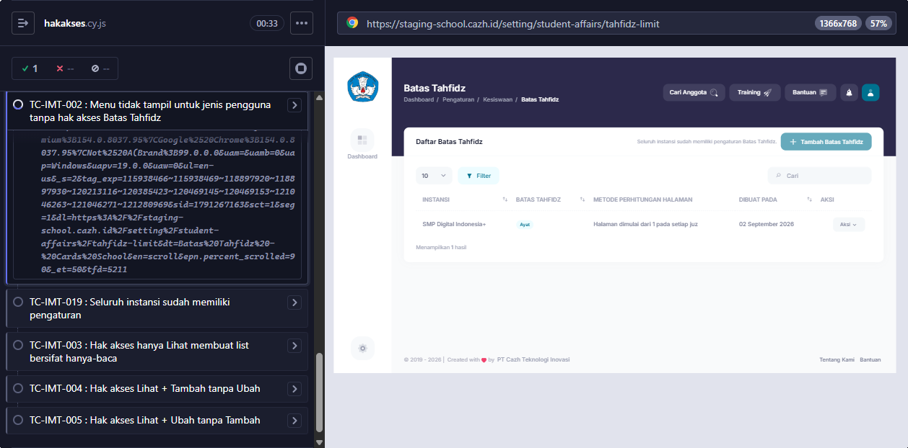
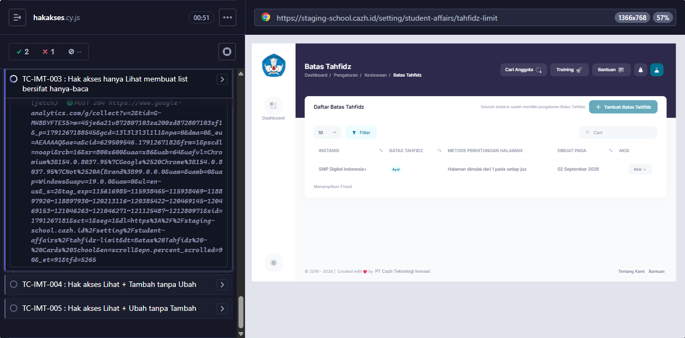
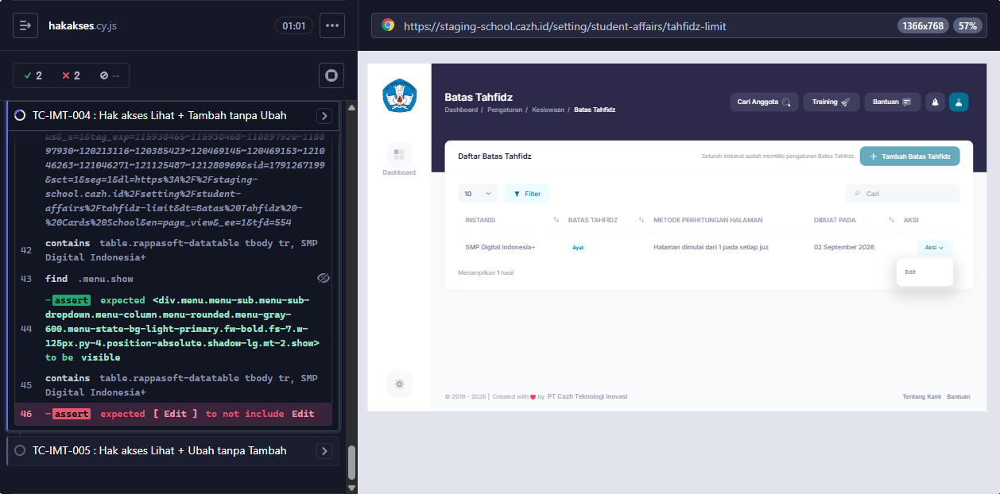

# BUG-016 — Hak akses Batas Tahfidz tidak punya aksi Lihat / Tambah / Ubah

**Modul:** Pengaturan > Pengguna > Jenis Pengguna (item Pengaturan > Kesiswaan > Batas Tahfidz) · **Severity:** High (akses halaman tanpa izin lewat URL) · **Ditemukan:** 6 Oktober 2026 (observasi form lewat Claude in Chrome + source origin/staging + Cypress TC-IMT-002..005)

## Langkah
1. Login sebagai admin > Pengaturan > Pengguna > Jenis Pengguna > Tambah.
2. Buka grup Pengaturan, centang modul Kesiswaan, lihat sub-modul **Batas Tahfidz**.

## Expected (PRD; TC-IMT-003, 004, 005, 006)
Item Kesiswaan Batas Tahfidz punya aksi **Semua, Lihat, Tambah, Ubah**. Centang Semua mengaktifkan seluruh aksi, melepas Lihat ikut melepas Tambah & Ubah. Akibatnya di halaman Batas Tahfidz:
- hanya Lihat → tombol Tambah dan aksi Edit tidak tampil,
- Lihat + Tambah → Tambah tampil, Edit tidak,
- Lihat + Ubah → Edit tampil, Tambah tidak.

## Actual
- Batas Tahfidz hanya **satu checkbox on/off** (struktur form: Grup → Modul → Sub-modul, semuanya boolean). Tidak ada aksi Lihat/Tambah/Ubah.
- Jenis pengguna "QA BT Lihat", "QA BT Lihat Tambah", "QA BT Lihat Ubah", dan "QA BT Semua" jadi **identik**.
- Halaman `setting/student-affairs/tahfidz-limit` tidak memeriksa izin aksi sama sekali: tombol Tambah Batas Tahfidz dan aksi Edit selalu tampil (`index.blade.php`, `table-row.blade.php` tanpa `MiddlewareMenuAccess::can...`).

## Catatan izin halaman (dicek oleh TC-IMT-002)
- Sidebar: `MiddlewareMenuAccess::canSubmenu('setting', 'student-affairs', 'student-affairs-tahfidz-limit')` (`components/layout/a-side/footer.blade.php`).
- Route: hanya `permission:setting,student-affairs` (`routes/cazh/setting.php`) → **TERKONFIRMASI (Cypress TC-IMT-002, 6 Okt 2026):** akun "QA BT Tanpa" (punya Tipe Pelanggaran + Perizinan, tanpa Batas Tahfidz) tidak melihat submenu, tetapi **bisa membuka** `/setting/student-affairs/tahfidz-limit` lewat URL langsung (list tampil, tombol Tambah & Edit tersedia).

## Saran fix
Tambah aksi (lihat/tambah/ubah) pada item `student-affairs-tahfidz-limit` di konfigurasi hak akses (Main System), cek di view (`@if (MiddlewareMenuAccess::can...('add'/'edit'))`) dan di method Livewire (`submit_tahfidz_limit`, `open_modal_add`, `set_edit_tahfidz_limit`), serta jaga route dengan izin sub-modul yang sama dengan sidebar.

<!-- AUTO:START -->
## Evidence otomatis (2026-10-06)

**Judul:** Hak akses Batas Tahfidz tidak punya aksi Lihat/Tambah/Ubah
**TC terkait:** TC-IMT-002, TC-IMT-003, TC-IMT-004, TC-IMT-005

Keterangan diff assertion: baris `-` = hasil AKTUAL app, baris `+` = EXPECTED (PRD/keputusan).

### TC-IMT-002
```
AssertionError: Timed out retrying after 10000ms: halaman Batas Tahfidz tidak bisa dibuka lewat URL: expected 1 to equal 0
```


### TC-IMT-003
```
AssertionError: Timed out retrying after 10000ms: tombol Tambah tidak tampil: expected 1 to equal 0
```


### TC-IMT-004
```
AssertionError: expected [ 'Edit' ] to not include 'Edit'
```


### TC-IMT-005
```
AssertionError: Timed out retrying after 10000ms: tombol Tambah tidak tampil: expected 1 to equal 0
```


<!-- AUTO:END -->
